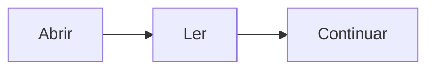

# Primeiro documento

Documento de teste para a seleção múltipla e a leitura de imagens locais.

## Diagrama

## Matemática

$$
\frac{1}{2} + \frac{1}{2} = 1
$$

[Ir ao segundo documento](./Segundo.md#final)
